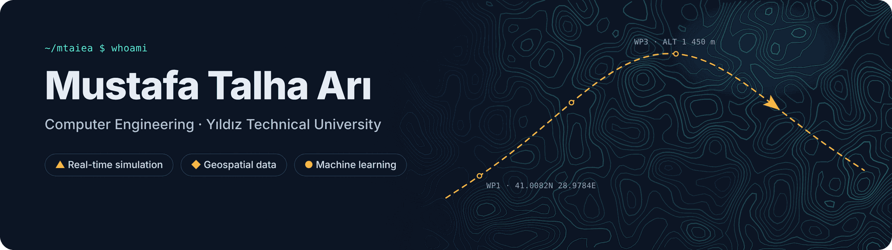
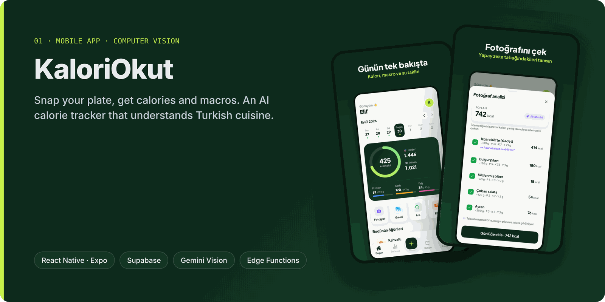
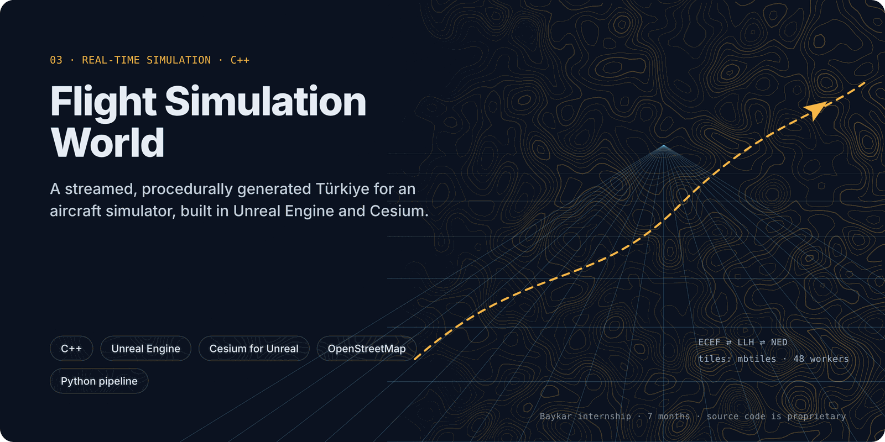
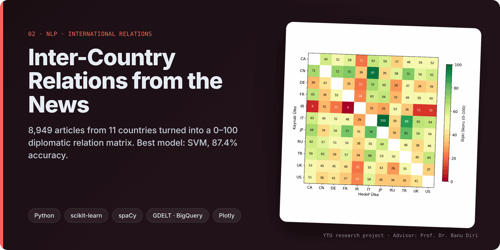
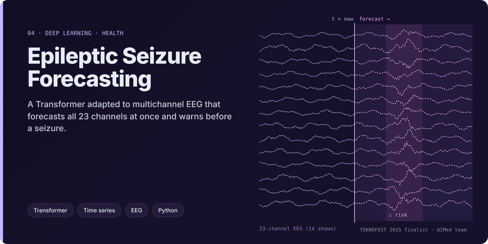

  

  
  
  

I'm a 4th-year Computer Engineering student at **Yıldız Technical University**. I build **real-time simulations**, **large-scale geospatial data pipelines** and **machine-learning systems**.

- ✈️ Spent **7 months at Baykar** on an aircraft simulation world in **Unreal Engine + Cesium** (C++)
- 🗺️ Processed **~500M rows of GPS/GIS data** and built analysis agents at **Mapin Data**
- 🏆 **1st place** at the İTÜ AI Competition (Mostra Hackathon) · **TEKNOFEST 2025 finalist**
- 📱 Currently shipping **KaloriOkut**, an AI calorie tracker for Turkish cuisine

---

## Featured work

<table>
  <tr>
    <td width="50%" valign="top">
      
      <b><a href="https://github.com/mtaiea/kaloriokut">KaloriOkut</a></b> 
      Photograph your plate and Gemini Vision estimates calories and macros. Built with React Native, Expo and Supabase.
    </td>
    <td width="50%" valign="top">
      
      <b><a href="https://github.com/mtaiea/flight-sim-world">Flight Simulation World</a></b> 
      A procedural, streamed model of Türkiye for an aircraft simulator, built with C++, Unreal Engine and Cesium.
    </td>
  </tr>
  <tr>
    <td width="50%" valign="top">
      
      <b><a href="https://github.com/mtaiea/inter-country-relations-nlp">Inter-Country Relations from the News</a></b> 
      8,949 news articles turned into a diplomatic relation matrix. The best model, an SVM, reached 87.4% accuracy.
    </td>
    <td width="50%" valign="top">
      
      <b><a href="https://github.com/mtaiea/epilepsy-seizure-forecasting">Epileptic Seizure Forecasting</a></b> 
      A Transformer that forecasts all 23 EEG channels at once. TEKNOFEST 2025 finalist.
    </td>
  </tr>
</table>

## Highlights

| | Competition | Result |
|---|---|---|
| 🥇 | **İTÜ AI Competition: Mostra Hackathon** (Mapin Data × Team Mostra), 2025 | **1st place**, ₺40,000 prize. Our model found high-potential districts in Istanbul big data and mapped them as a heatmap. |
| 🏅 | **TEKNOFEST 2025**: Technology for Humanity, Health | **Finalist** out of 3,216 teams. I was the team's only software developer. |
| 🏅 | **YTU × Beko Hackathon**, 2025 | **5th place**. We built a model that predicts how a robot vacuum should be optimised for each floor surface. |
| 🏅 | **TEKNOFEST Financial Technologies** | **17th of 124** as project captain, with an app that digitises real-estate workflows. |

## Experience

- **Baykar**: Long-term Intern, Simulation Systems · *Feb – Aug 2026* 
  Unreal Engine / Cesium flight-sim world in C++, a procedural world from OSM and Overture data, a Python tile pipeline for all of Türkiye, and performance tuning
- **Mapin Data**: Data Analyst & Agent Developer · *Jun – Aug 2025* 
  About 500M rows of GIS/GPS data turned into user profiles, plus an agent for the Bayer project that analysed post-pharmacy consumption and logistics
- **Bilim Güngören (T3 Foundation)**: Intern, instructor and mentor · *Nov 2023 – Jan 2024*

## Toolbox

  

- **Simulation & graphics:** Unreal Engine · Cesium for Unreal · Ultra Dynamic Sky · Blender · procedural meshes · LOD · terrain streaming
- **Geodata:** OpenStreetMap · Overture · mbtiles · GIS/GPS · ECEF / LLH / NED transforms
- **AI / ML:** Transformers · LSTM · time series · NLP (TF-IDF, spaCy) · scikit-learn · computer vision
- **Certifications:** Cisco CyberOps Associate · CCNA: Introduction to Networks · Introduction to Cybersecurity · NDG Linux Unhatched
